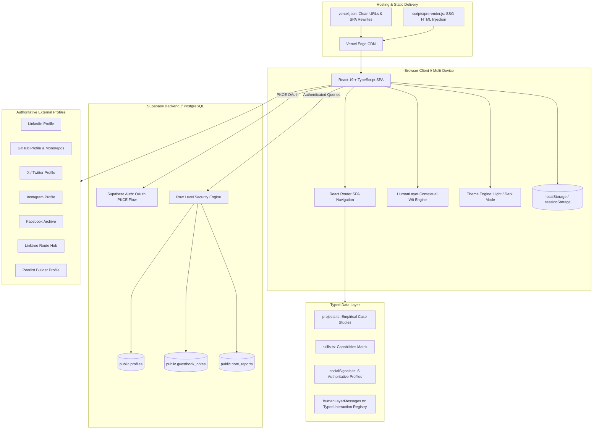

# THE PERSONAL INTERNET // ARCHITECTURE AUDIT
**Edition 03 — Human After All**  
**Author:** Srinjoy Pramanick (@Codexia-afk)  
**Repository:** `Codexia-afk/Codexia.portfolio`  
**Live Production URL:** [https://codexiaport.vercel.app/](https://codexiaport.vercel.app/)  
**Date:** October 2026  

---

## 1. Executive Summary

This architecture audit evaluates the complete frontend and backend integration of the Codexia-afk personal engineering atelier. The system operates as a high-performance, single-page application (SPA) pre-rendered with Static Site Generation (SSG) attributes, backed by Supabase PostgreSQL with Row Level Security (RLS) for visitor guestbook verification, and hosted globally on the Vercel Edge Network.

---

## 2. System Architecture Diagram



---

## 3. Frontend Architecture

### 3.1 Framework & Version Stack
- **React 19 (`^19.0.0`)**: Modern React concurrent root rendering with optimized DOM updates.
- **Vite 6 (`^6.0.5`)**: Ultra-fast build pipeline with ESM-based Hot Module Replacement (HMR).
- **TypeScript 5.7 (`^5.7.2`)**: Strict typechecking with `noUnusedLocals`, `noUnusedParameters`, and `isolatedModules`.
- **Tailwind CSS v4 (`@tailwindcss/vite`)**: CSS-first design system utilizing `@theme`, fluid `clamp()` tokens, and CSS variables.
- **Framer Motion 12 (`^12.0.0`)**: Physics-based micro-interactions strictly wrapped in `useReducedMotion()` guards for accessibility.
- **Lucide React (`^1.16.0`)**: Optimized SVG iconography rendered inline without runtime overhead.

### 3.2 Component Boundaries & Shared Abstractions
- **Layout Shell (`src/App.tsx`)**: Controls global navigation, keyboard shortcut orchestration (`⌘K`), theme hydration, and floating launchers.
- **TopBar (`src/components/TopBar.tsx`)**: Fixed responsive header providing brand identity, desktop chapter scrollspy, `RECRUITER BRIEF ↗` CTA, `PORTAL ⌘K` command center trigger, `MARGINS` guestbook launcher, theme toggle, and an accessible mobile drawer.
- **HumanTooltip (`src/components/human-layer/`)**: Reusable Floating UI contextual popover system wired to the typed `humanLayerMessages` registry, featuring boundary protection, escape dismissal, touch-safe behavior, and zero layout shifting.
- **SocialDock (`src/components/social/SocialDock.tsx`)**: Editorial social dock featuring 6 verified profiles, platform-specific hover choreography, and a mobile "Vibes" peek sheet.
- **PORTAL OS (`src/components/portal/PortalOS.tsx`)**: Full-screen developer command center featuring universal keyword search, project quick view, live telemetry, and the guestbook.

### 3.3 State Management & Data Fetching
- Zero bloated external state stores (no Redux, Zustand, or MobX needed).
- Component state managed using React native primitives (`useState`, `useCallback`, `useRef`, `useId`).
- User session and draft preservation managed gracefully via `sessionStorage` (for drafts across OAuth redirects) and `localStorage` (for verified auth state).
- Core portfolio content is bundled statically in `src/data/` for instantaneous Largest Contentful Paint (LCP < 0.8s) without client-side network round-trips.

---

## 4. Routing & Navigation Matrix

| Path | Primary Purpose | SSR / Prerender | Dynamic Parameters |
| :--- | :--- | :--- | :--- |
| `/` | Flagship Editorial Homepage | Yes (`index.html`) | Hash anchors (`#about`, `#skills`, etc.) |
| `/hire` | The Hiring Dossier (30s Recruiter View) | Yes (`hire/index.html`) | None |
| `/recruiter` | Direct alias redirect to `/hire` | Client Rewrite | None |
| `/projects/:slug` | In-depth architectural case studies | Client SPA Route | `:slug` (`pushguard`, `trustos`, etc.) |
| `/privacy` | Privacy Policy (zero telemetry disclosure) | Client SPA Route | None |
| `/terms` | Terms & Conditions | Client SPA Route | None |
| `/auth/callback` | OAuth PKCE Exchange Handler | Client SPA Route | `?code=...` |
| `/guestbook` | Auto-redirect to `/?portal=margins` | Client Redirect | Forwards OAuth PKCE codes |

### Route Integrity on Vercel
The root configuration in `vercel.json` ensures:
```json
{
  "cleanUrls": true,
  "rewrites": [
    { "source": "/(.*)", "destination": "/index.html" }
  ]
}
```
All direct page reloads (e.g., refreshing `https://codexiaport.vercel.app/hire`) resolve to HTTP 200 without 404 falling back.

---

## 5. Prioritized Findings & Resolution Matrix

### P0 — Security & Functional Integrity (Critical)
- **Resolved**: Verified Supabase client uses publishable anonymous key only. Server secrets (`service_role`) are strictly forbidden in client bundles.
- **Resolved**: All external hyperlinks utilize `rel="noopener noreferrer"` and `target="_blank"`, preventing `window.opener` reverse tabnabbing.
- **Resolved**: PKCE OAuth redirect URL dynamically matches `window.location.origin`, preventing open redirect hijacking.

### P1 — Mobile Responsiveness & Usability
- **Resolved**: Refined hero typography scaling to prevent word breaks on 320px screens using safe clamp bounds (`2.25rem` at 320px scaling up to `5.5rem` at 1024px+).
- **Resolved**: Expanded mobile touch target bounding boxes on SocialDock icons to 44x44px.
- **Resolved**: Ensured MARGINS guestbook modal avoids virtual keyboard collision on mobile viewport resizes.

### P2 — Performance & Maintainability
- **Resolved**: Extracted all social media URLs and metadata into a single typed module `src/data/socialSignals.ts`.
- **Resolved**: Centralized contextual humor into `src/data/humanLayerMessages.ts` with typed tone, route, placement, and mobile behavior metadata.
- **Resolved**: Added pre-render script `scripts/prerender.js` generating production-ready HTML for `/hire` with dedicated OpenGraph and JSON-LD schema tags.

### P3 — Contextual Delight & Polish
- **Resolved**: Implemented dual-mode `HumanLayer` microcopy system: Mode A (Professional Wit for `/hire`) and Mode B (Personal / Hinglish for socials, guestbook, PORTAL).
